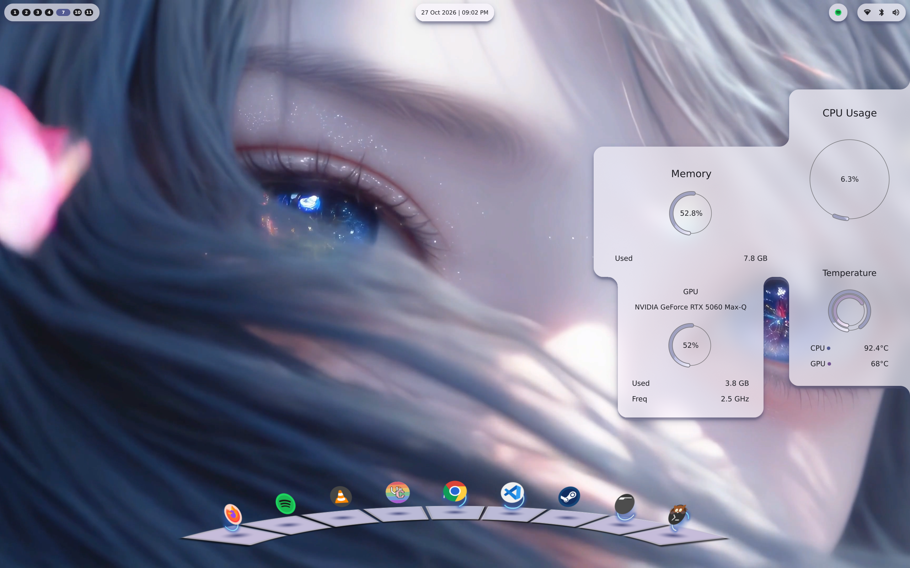
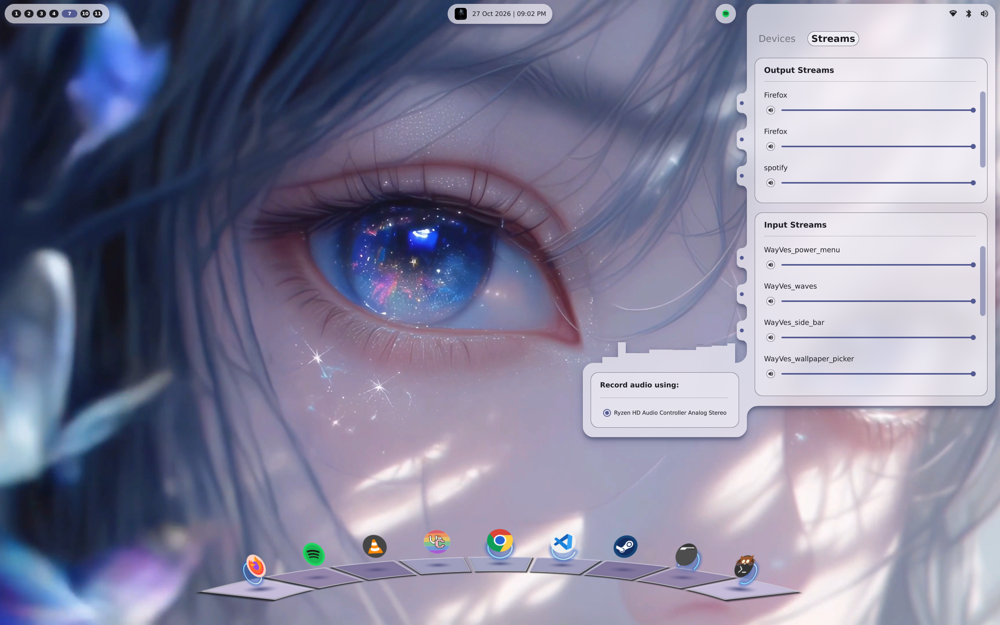
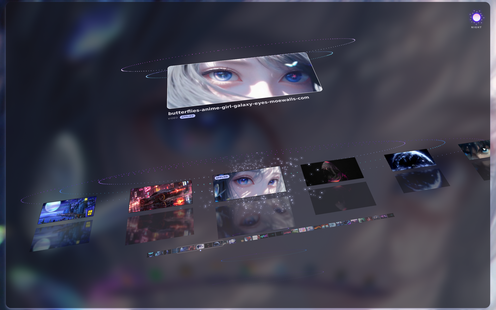
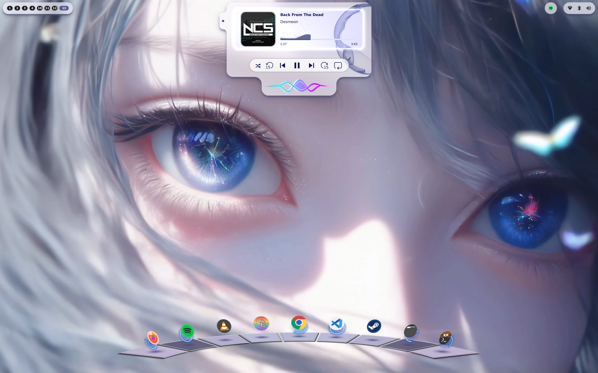
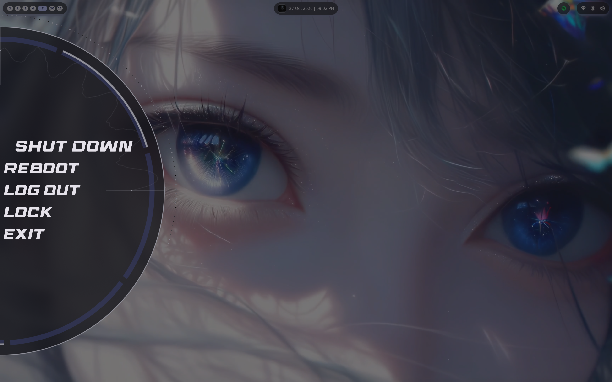
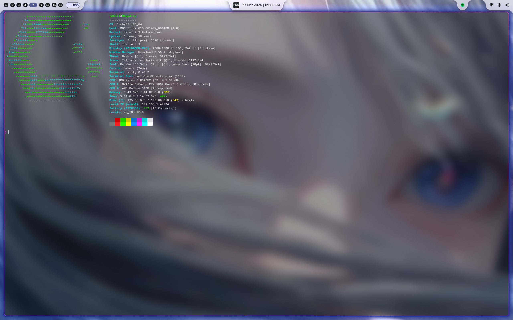

# WayVes Shell

A [Quickshell](https://quickshell.outfoxxed.me) desktop shell for Hyprland where the visuals are live [WayVes](https://github.com/Roonil/WayVes) audio visualisers. WayVes renders them in its own process and exports each one as a DMA-BUF, and the shell shows them inside its panels through `DMABufSurface`, from [this Quickshell fork](https://github.com/Roonil/quickshell). Nothing is copied; the shell samples WayVes' output straight from the GPU.

Almost every element is a **Notch**: a panel that grows out of a screen edge or out of another notch, with curved joins where they meet. Child notches protrude from their parent's edges and merge into its outline, and edges snap to device pixels so joins stay seamless at fractional scales.

## Showcase

Each WayVes instance used is a headless OpenGL program that hands over its final output to Quickshell via DMA-BUF fds that it can use to display natively. The background card in the Media widget, the progress rings in the sidebar and the theme switch button in the Wallpaper Picker are also WayVes instances used as surfaces.

---

Sidebars that have a 'fluid' in them that reacts to audio. The Rings and the Fluid are all Angular WayVes instances. The bottom Dock with its app indicators is also an Angular WayVes instance.



---

Sound Controls that feature pavucontrol-like functionality. The audio bars (Linear WayVes instance) grab audio from the selected node, be it an application, output device or an input mic.



---

Wallpaper Picker with a background stage and a swarm of particles that shows the primary color from the wallpaper when hovered. The background and the particle swarm are Angular WayVes instances, and the top-right Theme switch button is also an Angular WayVes instance that changes to Sun/Moon for light/dark modes



---

Media Widget that offers MPRIS controls. The background card, the bouncing waves on the progress bar and the logo at the bottom of the Notch are all Linear WayVes instances. The ring on the right is an NCS WayVes instance.



---

Power Menu that shows options for locking, shutting down and rebooting. The background surface, the quarter waves and the rotating particles are all Angular WayVes instances.



---

Finally, a Notch system that can hug multiple surfaces. In the shell, the Notches hug the nearby surface whenever an application is active on the Workspace, and are individual pills when no application is active.



## Features

- **Top bar**: Workspaces on the left, and a clock in the centre that expands into the media widget and the wallpaper picker. Wi-Fi, Bluetooth, sound and the system tray are on the right.
- **Media widget**: MPRIS players, with a WayVes visualiser of what's playing.
- **Sound card**: per-application volume, plus a visualiser that can follow one application by capturing its PipeWire node.
- **Wallpaper picker**: images and videos from a folder, video previews in the filmstrip, and a theme switch for light and dark.
- **Theming**: [matugen](https://github.com/InioX/matugen) generates the palette from the wallpaper, and the colours are pushed into the WayVes shaders too, so the visualisers match the theme.
- **Dock**: a curved 3D dock with a WayVes visualiser behind the icons and visualiser rings as running/active indicators.
- **Side bar**: CPU, GPU and RAM usage and temperatures, drawn as WayVes rings.
- **Lock screen**: PAM authentication over a WayVes XMB-style background, with a visualiser as the password mask.
- **Power menu**: full keyboard navigation, and a countdown (5 seconds by default) before shutting down, rebooting or logging out.
- **Background**: image or video wallpapers.
- **Power-aware**: hidden visualisers stop rendering in WayVes, and every surface redraws at its own capped frame rate. See [BENCHMARKS.md](BENCHMARKS.md) for measured GPU power per state.

## Requirements

- **The [Quickshell fork](https://github.com/Roonil/quickshell)** with `DMABufSurface`. Upstream Quickshell can't load this shell.
- **[WayVes](https://github.com/Roonil/WayVes)** v1.3.0 or newer. The shell's visualiser configurations (`config.yaml`, `config_potato.yaml` and the `wayves-shell/` shaders) ship with WayVes.
- **Hyprland**
- **PipeWire**, **NetworkManager**, **BlueZ** and **PAM**, through Quickshell's services
- **Qt Multimedia** for video wallpapers and previews
- **matugen** for theming
- **ffmpeg** for video thumbnails
- **lm_sensors** for the CPU temperature
- **nvidia-smi** and **lspci** for the GPU stats (NVIDIA only for now)

## Running

1. After installing WayVes, copy the contents of `WayVes Shell` from `advanced-configs` to `~/.config/WayVes/
2.  Start WayVes first:
   ```sh
   WayVes                  # the full shell
   WayVes -f config_potato # or the lighter one, for weaker GPUs
   ```
   WayVes has to be running before Quickshell starts: each surface connects to its socket in `/tmp/WayVes` once, at start-up.
   
3. Clone this repo, copy `wayves-shell` to `~/.config/quickshell/wayves-shell`, and `matugen` to `~/.config/matugen` and start it with the fork's binary:
   ```sh
   quickshell -c wayves-shell
   ```

## Configuration

Everything configurable is in [`Properties/Properties.json`](Properties/Properties.json). It comes with a [JSON Schema](Properties/Properties.schema.json), so editors that support `$schema` give completion and descriptions for every key. The main sections are:

| Section | What it covers |
| --- | --- |
| `performance` | `potato` for a lighter shell, and per-surface frame rates (`visualiserFps`, `usageFps`, `dockFps`, `hudSurfaceFps`) |
| `notch` | Shared notch defaults: `overshoot`, `squash`, `panelOpacity` |
| `bars` | Top and side bars: exclusive zone, attach behaviour when a window is open, and per-notch sizes |
| `dock` | Dock geometry, tilt and sweep angles, indicator sizes, and hover and activation areas |
| `lockscreen` | Lock screen notch sizes |
| `powerMenu` | Countdown in seconds for each action (`shutdown`, `reboot`, `logout`, `lock`) |
| `wallpapers` | `directory` (default `~/Pictures/Wallpapers`) |

Set `"performance": { "potato": true }` to cap the visualisers at 10 fps, the usage rings at 2 and the dock at 1, play video wallpapers from a lighter preview copy, and turn off video previews in the picker. Pair it with `WayVes -f config_potato`.

## Keybinds

The `powerMenu` and the `wallpaperPicker` are toggled by a `quickshell ipc` command. On Hyprland, the relevant keybinds can then, for instance, be:

```
bind = $mainMod SHIFT, P, exec, quickshell -c wayves-shell ipc --any-display call showPowerMenu toggle 
bind = $mainMod SHIFT, W, exec, quickshell -c wayves-shell ipc --any-display call showWallpapers toggle 

```

## Bugs / Stuff that doesn't work yet
- No notifications/display/battery as of yet
- `Output Streams` within the Sound Panel sometimes don't open their notches on hover; this is most-probably a QtQuick-related hover check issue.
- Matugen color palette selection, though theme color updates do work dynamically.

## Notes

[Developer's Notes from Hell](Developer's%20Notes%20from%20Hell/Notes.md) is the story of how the Notch, the Dock and `DMABufSurface` came together, and everything Qt threw back along the way. Not technically reliable, as it says itself.
